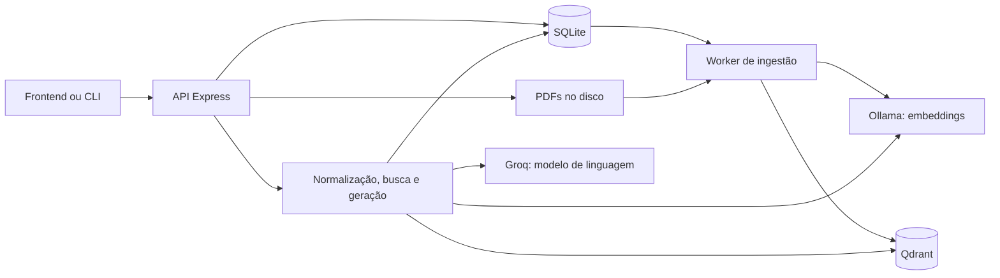

# Arquitetura

## Componentes e persistência

| Componente | Responsabilidade | Implementação |
| --- | --- | --- |
| API | HTTP, uploads, validação, SSE e diagnóstico | [server.ts](../src/server.ts) |
| SQLite | Documentos, estados de ingestão e evidências de conversas | [schema.ts](../src/db/schema.ts) |
| Worker | Reivindicar e processar tarefas persistidas | [service.ts](../src/ingestion/service.ts), [worker.ts](../src/ingestion/worker.ts) |
| Ingestão | Extração, divisão, embeddings e publicação | [document.ts](../src/ingestion/document.ts) |
| Recuperação | Busca vetorial e filtros de metadados | [search.ts](../src/retriever/search.ts) |
| Geração | Resposta em streaming a partir das evidências | [generator.ts](../src/rag/generator.ts) |

O SQLite usa WAL, chaves estrangeiras e timeout para disputa de escrita. As migrações aditivas são executadas automaticamente na inicialização. PDFs ficam em `data/pdfs` por padrão; vetores ficam no armazenamento do Qdrant.

## Ingestão de documentos

1. A API valida PDF e metadados, salva o arquivo e registra uma tarefa `queued` no SQLite.
2. Um worker obtém a tarefa em transação e mantém uma concessão temporária de execução com heartbeat.
3. O texto é extraído por página e dividido em trechos, preservando contexto de títulos e artigos. Referências de página são associadas quando identificadas.
4. O Ollama gera embeddings; os vetores da nova versão são gravados no Qdrant com `indexed=false`.
5. A versão é publicada, os vetores antigos são removidos e a tarefa chega a `completed`, com progresso de 100%.

A versão depende do PDF, dos metadados, do modelo e da versão do particionamento. IDs dos trechos são determinísticos. Uma versão idêntica já publicada pode ser reutilizada, evitando gerar embeddings novamente.

A versão anterior permanece consultável durante o processamento da substituta. Trechos ainda em preparação são excluídos da busca. Uma falha na limpeza após publicação pode deixar a versão nova disponível mesmo que o job seja marcado como falho; uma nova tentativa permite concluir a operação.

Tarefas interrompidas são recuperadas após a concessão expirar. Vários workers compartilham o mesmo SQLite e os mesmos PDFs **no mesmo host**, em disco local. Essa implementação não fornece uma fila distribuída para hosts diferentes.

## Consulta e conversa

O cliente envia o histórico. A normalização da pergunta usa a Groq; a busca usa embeddings do Ollama e o Qdrant; a geração transmite o texto pela Groq. Normas marcadas como revogadas e vetores não publicados são excluídos da recuperação.

O cliente pode filtrar esfera e jurisdição. A preferência municipal depende de um pedido explícito e de uma jurisdição informada. Documentos antigos sem jurisdição precisam de atualização e reindexação para participar corretamente desses filtros.

O SQLite persiste as evidências da conversa com prazo de expiração, mas não guarda o histórico completo. O frontend deve continuar enviando `history` e conservar o `conversationId` retornado. Perguntas técnicas de acompanhamento executam nova busca; pedidos de reformatação podem reutilizar evidências depois de validar sua existência no Qdrant.

PDFs e embeddings são locais. Histórico e trechos relevantes passam pela Groq, um serviço externo. Quando não há evidências recuperadas, o sistema informa que não encontrou embasamento na legislação cadastrada.

## Limites atuais

- Não há OCR; PDFs sem camada de texto não podem ser ingeridos corretamente.
- Metadados de vigência, jurisdição e URL oficial dependem do cadastro; o sistema não verifica automaticamente a validade jurídica da norma.
- Similaridade vetorial não representa probabilidade de acerto.
- As referências retornadas indicam evidências recuperadas; isso não garante que todas sejam citadas ou sustentem cada afirmação da resposta.
- O modo atual de acesso é aberto na intranet, sem contas de usuário ou isolamento de conversas por identidade.
